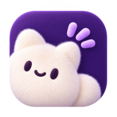

<div align="center">
  
  <h1>MoMo bot</h1>
  <p>A chat app for running a team of AI agents on your computer or your own server.</p>
</div>

MoMo bot is maintained in [OneWhitepaper/MoMo-Bot](https://github.com/OneWhitepaper/MoMo-Bot). It supports a local workspace, multiple bots and conversations, and optional AI providers and integrations configured by the operator.

## Run the desktop app from source

Install Node.js 24 or newer and pnpm. In this checkout, run `pnpm install --frozen-lockfile`. Start these three commands in separate terminals:

```sh
pnpm dev:server
pnpm dev --strictPort
pnpm dev:desktop
```

The server listens on `127.0.0.1:8799` and Vite on `127.0.0.1:5199`. To run a second development instance, set `OMB_PORT` to the same free port in all three shells, use a separate `OMB_UI_PORT` for Vite, and set `ELECTRON_START_URL` for Electron to match. Give it a separate `OMB_DATA_DIR` and pass `--user-data-dir` to Electron. MoMo bot normally stores workspace data in `~/.momobot`; phone pairing uses `~/.momobot-companion`. It does not move data from the upstream app on first launch.

Run `pnpm typecheck`, `pnpm i18n:check`, and `pnpm test:electron` before shipping changes to the desktop app. For server or conversation changes, follow the [isolated fixture guide](docs/verification/README.md). [DESIGN.md](DESIGN.md) and [docs/localization.md](docs/localization.md) cover the app interface and translations. The source art for desktop and installer icons is `public/momo-bot.png`; `node build/render-icons.mjs` (macOS) and `node build/dmg/render.mjs` regenerate the derived images.

## Builds and updates

Use `pnpm package:mac`, `pnpm package:win`, or `pnpm package:linux` for the respective platform. Build artifacts go to `release/`. macOS distribution signing and notarization, and any Windows signing, require certificates controlled by the publisher. The desktop app does not check for or install upstream releases. Fetch and review upstream changes manually before integrating them; `origin` is the MoMo bot repository.

Hosted features are optional. A compatible cloud deployment must be supplied with `MOMO_CLOUD_URL`; phone services and the connected apps broker use explicit `OMB_CONTROL_PLANE_URL` and `OMB_COMPOSIO_BROKER_URL` settings. Direct integrations can use your own keys. The desktop and web UI do not send upstream usage analytics. Some internal configuration names and wire identifiers retain `OMB` or `openmausbot` for compatibility.

## Self-hosting

Run `docker compose up -d --build` in this checkout to build the server from source and open it at `http://127.0.0.1:8080`. The [public HTTPS stack](deploy/docker-compose.yml) also builds from this checkout, or can use your own `OMB_IMAGE`. Fresh Docker and Podman installations from `deploy/install.sh` or `deploy/podman/install.sh` require an explicit image in `OMB_INSTALL_IMAGE`. For image-based installs, run `./update.sh --image IMAGE` on the host to update with a backup and rollback. Source installs are updated by checking out the desired revision and rebuilding.

## Source and licensing

MoMo bot is based on [OpenMausBot](https://github.com/milind-soni/OpenMausBot). The open-source portions retain the [Apache 2.0 license](LICENSE) and [upstream notices](NOTICE). [LICENSING.md](LICENSING.md) explains the distinct terms for `enterprise/`; downstream release builds exclude that overlay. The original authors, notices, and third-party licenses remain credited.
